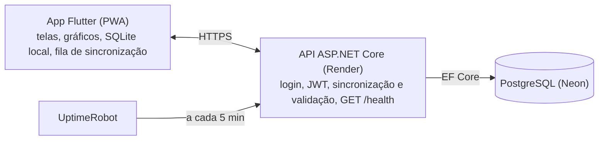

# Nosso Combustível — Escopo do Projeto

Atualizado em 29/10/2026.

## Visão geral

Nosso Combustível é um app de celular para saber quanto cada carro gasta com energia, seja combustível ou eletricidade. Ele mostra o gasto por semana e por mês, o consumo real e quanto o carro roda. O mesmo app atende carro a combustão, híbrido e 100% elétrico, e compara todos pela mesma régua: **R$ por km**.

- **Para quem:** quem idealizou o app e os colegas de trabalho. É um projeto de hobby. Se pegar, cresce.
- **Problema:** o gasto com combustível é sentido no bolso, mas ninguém sabe o número exato nem se o carro está consumindo mais que o normal.
- **Diferencial:** os três tipos de energia num lugar só, carro compartilhado entre pessoas (o "Nosso" do nome), a regra etanol x gasolina e, numa fase posterior, a comparação de trajetos.
- **Plataforma principal:** PWA feito em Flutter Web, instalado pelo navegador do celular (Android e iPhone), sem loja. O app nativo das lojas chega na Fase 2, junto com os trajetos.

## Tipos de veículo e energia

O tipo do carro é definido pelas **fontes de energia** que ele usa. Cada registro é um *Abastecimento* (litros) ou uma *Recarga* (kWh). Assim, o híbrido plug-in tem os dois tipos de registro sem regra especial.

| Tipo | Fontes | Registra | Cor | Métrica de consumo |
| --- | --- | --- | --- | --- |
| Combustão (gasolina, diesel) | Combustível | Abastecimento | Laranja | km/l |
| Flex | Gasolina e etanol | Abastecimento, indicando o combustível | Laranja | km/l por combustível |
| Híbrido comum (HEV) | Combustível | Abastecimento | Azul | km/l |
| Híbrido plug-in (PHEV) | Combustível e eletricidade | Abastecimento e recarga | Azul | km/l, km/kWh e R$/km total |
| Elétrico (BEV) | Eletricidade | Recarga | Verde | km/kWh |

- **Abastecimento:** data, odômetro, combustível, litros, preço por litro, valor total, tanque cheio (sim/não), posto (opcional), quem abasteceu.
- **Recarga:** data, odômetro, kWh, local (casa, trabalho ou eletroposto), preço por kWh, valor total, carga até 100% (sim/não), percentual de bateria antes e depois (opcional).
- **Recarga em casa:** o preço vem da tarifa cadastrada pelo usuário (R$/kWh da conta de luz). Basta informar os kWh.

**Cadastro do carro**

- **Pela tabela FIPE:** marca, depois modelo, depois ano e combustível, usando a API pública da FIPE (Parallelum). A nossa API consulta a FIPE e guarda em cache, porque marcas e modelos mudam pouco. Assim o app não esbarra no limite diário nem para se a FIPE cair.
- **O tipo de energia sai do modelo escolhido, sem passo extra.** A API combina o combustível informado pela FIPE com palavras do nome do modelo (Flex, Hybrid, DM-i, Elétrico). A tela mostra só um resumo ("Combustão · Diesel") com um botão Corrigir para os raros casos em que a FIPE erra.
- **Sem a FIPE:** sempre há a opção de cadastrar digitando marca e modelo, para carro importado, antigo ou que não aparece na tabela.
- **Diesel:** entra como combustão (laranja), com o abastecimento indicando Diesel S10 ou S500. O ARLA 32 fica para a Fase 3, junto com a manutenção.

## Métricas e regras de cálculo

O consumo é calculado pelo **método do tanque cheio**. Ele só é confiável entre dois abastecimentos completos. Abastecimentos parciais no meio somam litros, mas não fecham um ciclo.

```
km/l = (odômetro no cheio atual − odômetro no cheio anterior) ÷ litros abastecidos desde o cheio anterior, incluindo o atual
```

| Métrica | Como é calculada | Onde aparece |
| --- | --- | --- |
| km/l | Tanque cheio a tanque cheio, separado por combustível no flex | Tela do carro e histórico |
| km/kWh | Mesmo método, usando as recargas até 100% (ou o percentual de bateria quando informado) | Tela do carro |
| R$/km | Gasto total do período ÷ km rodados no período | Início, comparativo entre carros |
| Gasto semanal e mensal | Soma dos valores dos registros na semana (segunda a domingo) e no mês | Início e relatórios |
| Km rodados | Diferença de odômetro entre o primeiro e o último registro do período | Início |
| Projeção do mês | Média diária de km e de R$ nos últimos 30 dias × dias do mês | Início |
| Etanol x gasolina | Etanol compensa quando o preço dele é até 70% do da gasolina. Com histórico próprio, usa a razão real km/l etanol ÷ km/l gasolina do carro | Ao registrar abastecimento no flex |
| Alerta de consumo | km/l do ciclo 15% abaixo da média dos últimos 5 ciclos | Notificação e destaque no histórico |

- **Odômetro:** o app sempre guarda a leitura informada, nunca a distância já calculada. Leitura menor que a anterior é recusada.
- **Valores:** o usuário informa dois de três (litros, preço por litro, total) e o app calcula o terceiro.

## Funcionalidades por fase

O MVP é só registro manual e painéis, sem GPS. Os trajetos só entram depois que o MVP estiver em uso pelos amigos.

### MVP: abastecimentos, recargas e painéis

- Cadastro e login (e-mail e senha, Google; Apple quando publicar na App Store)
- Cadastro de carros: apelido, marca, modelo, ano, tipo de energia, capacidade do tanque e da bateria, odômetro inicial, foto opcional
- Registro de abastecimento e de recarga em até 3 toques a partir da tela inicial
- Tela inicial do carro ativo: gasto da semana e do mês, km rodados, R$/km, consumo médio, projeção do mês e últimos registros
- Histórico com filtro por período e por tipo de registro, edição e exclusão
- Relatórios: gasto por mês (últimos 12 meses), consumo por ciclo, comparativo entre carros do usuário
- Calculadora etanol x gasolina no momento do abastecimento
- Carro compartilhado por convite (ver Contas)
- Distribuído como PWA: a turma recebe um link e instala pelo navegador. Funciona sem internet e sincroniza depois
- Tema claro e escuro, cor de destaque pelo tipo do carro ativo

### Fase 2: trajetos

- App nativo para Android e iPhone (Play Store e App Store). É necessário porque o PWA não grava GPS em segundo plano.
- Gravar trajeto com GPS em segundo plano (iniciar e parar manualmente; detecção automática depois)
- Resumo do trajeto: distância, duração, velocidade média, paradas e custo estimado pelo R$/km do carro
- Consumo do trajeto informado pelo usuário a partir do computador de bordo (opcional)
- Trajetos frequentes: agrupar pelo mesmo início e fim e comparar os caminhos por distância, tempo, trânsito (tempo parado) e custo
- Mapa do trajeto com trechos coloridos por velocidade

### Fase 3: extras

- Leitura de consumo real com adaptador OBD-II Bluetooth (ELM327)
- Lembretes de manutenção por km ou data (troca de óleo, pneus, revisão)
- Ranking entre amigos (R$/km e km/l), com opt-in
- Preço médio por posto a partir dos registros da turma
- Layout próprio para PC, se fizer falta

## Contas, login e carro compartilhado

Cada pessoa tem sua conta. Um carro pode ser compartilhado entre várias contas por convite, e cada registro guarda quem o fez.

- **Login:** e-mail e senha (ASP.NET Core Identity) e Google. O "Entrar com Apple" é obrigatório quando o app for para a App Store com login social.
- **Sessão:** token JWT de curta duração + refresh token guardado no armazenamento seguro do celular. O usuário não precisa logar de novo a cada uso.
- **Recuperar senha:** por e-mail, com link de uso único.
- **Compartilhar carro:** o dono gera um convite (link ou código de 6 caracteres). Quem aceita vira participante.

| Papel | Registra abastecimento e recarga | Edita os próprios registros | Edita registros dos outros | Edita o carro | Convida e remove pessoas | Exclui o carro |
| --- | --- | --- | --- | --- | --- | --- |
| Dono | Sim | Sim | Sim | Sim | Sim | Sim |
| Participante | Sim | Sim | Não | Não | Não | Não |

- **Gasto por pessoa:** em carro compartilhado, os relatórios mostram quanto cada participante pagou. Isso ajuda a dividir a conta.
- **Excluir conta:** apaga os dados pessoais. Os registros em carros compartilhados ficam anônimos ("ex-participante").

## Stack e arquitetura

App em Flutter com banco local, API em C# e PostgreSQL no servidor. O app grava tudo primeiro no celular e sincroniza quando há internet, então o registro no posto nunca trava.



O UptimeRobot chama só o `/health`, que não consulta o banco. Assim a API fica acordada e o Neon pode dormir.

| Camada | Tecnologia | Papel |
| --- | --- | --- |
| App | Flutter (Dart) | PWA no MVP; Android e iPhone nativos na Fase 2, com o mesmo código |
| Estado e navegação | Riverpod, go_router | Organização das telas e dos dados |
| Banco local | SQLite com drift | Funciona sem internet (no PWA, SQLite em WASM guardado no navegador) |
| Gráficos | fl_chart | Gasto por mês, consumo por ciclo |
| Comunicação | dio, flutter_secure_storage | Chamadas à API, tokens guardados com segurança |
| Mapas e GPS (Fase 2) | flutter_map (OpenStreetMap), geolocator | Mapa gratuito e trajeto em segundo plano |
| API | ASP.NET Core (.NET 10) | Login, sincronização, relatórios |
| Acesso a dados | EF Core + Npgsql | Mapeamento para o PostgreSQL |
| Banco | PostgreSQL no Neon | Dados oficiais de todos os usuários |
| Hospedagem | Render (Docker) + UptimeRobot; PWA no Cloudflare Pages | API gratuita e sempre acordada |

**Regras de sincronização**

- IDs gerados no celular (UUID v7), então o registro já nasce com o ID definitivo.
- Toda tabela sincronizada tem `AtualizadoEm` e `ExcluidoEm`. Excluir só marca o registro.
- `GET /sync?desde=<data>` traz o que mudou no servidor. `POST /sync` envia o que mudou no celular.
- Conflito: vale a alteração mais recente de cada registro.

**Repositório:** um repositório só, com as pastas `api/` (solução .NET), `app/` (Flutter) e `docs/` (este escopo).

## Arquitetura do código

Na API: Clean Architecture com portas e adaptadores (hexagonal) e DDD tático onde há regra de negócio. No app: MVVM, que é a arquitetura recomendada no guia oficial do Flutter, com uma camada de domínio.

**API (.NET)**

| Projeto | Papel | Contém | Depende de |
| --- | --- | --- | --- |
| NossoCombustivel.Domain | Domínio | Agregado Veiculo (participantes e convites), Abastecimento e Recarga. Objetos de valor Odometro, Volume, Dinheiro e PrecoUnitario. Regras como "odômetro não volta" | Nada |
| NossoCombustivel.Application | Casos de uso e portas | Comandos e consultas (RegistrarAbastecimento, AceitarConvite, Sincronizar). Portas IVeiculoRepositorio, IEnvioEmail, IRelogio | Domain |
| NossoCombustivel.Infrastructure | Adaptadores de saída | EF Core com Npgsql, repositórios, Resend, cliente da FIPE com cache, validação do token do Google | Application |
| NossoCombustivel.Api | Adaptador de entrada | Endpoints (Minimal API), JWT, `/health`, `/sync` e a composição da injeção de dependência | Application (e Infrastructure só na composição) |
| Testes | Testes | xUnit em Domain e Application; testes de integração da Api | Os projetos testados |

**App (Flutter)**

| Pasta | Papel | Contém |
| --- | --- | --- |
| `lib/domain/` | Domínio | Entidades, objetos de valor e casos de uso: CalcularConsumo, ProjetarMes, CompararEtanolGasolina |
| `lib/data/` | Dados | Repositórios, banco local (drift), cliente da API (dio), sincronização |
| `lib/ui/<tela>/` | Apresentação (MVVM) | Uma View e um ViewModel por tela: início, abastecimento, recarga, histórico, relatórios, carros, login |
| `lib/core/` | Transversal | Tema por tipo de energia, rotas, injeção de dependência |

- **Os cálculos ficam no domínio do app** (km/l, R$/km, projeção), porque precisam funcionar sem internet. A API valida as regras (odômetro, valores positivos) e guarda os dados, sem recalcular métricas. Assim a regra não fica duplicada em duas linguagens.
- **ViewModels com Riverpod** (Notifier), que já está na stack. O ViewModel expõe estado e comandos; a View só desenha.
- **Sem MediatR e AutoMapper:** os dois passaram a ter licença comercial em 2025. Usar handlers simples e mapeamento manual.
- **DDD na medida:** boa parte do app é cadastro. Agregados e objetos de valor só onde há regra; o resto fica simples.

## Modelo de dados do MVP

O MVP tem oito tabelas. Todas as sincronizadas usam ID UUID v7, `CriadoEm`, `AtualizadoEm` e `ExcluidoEm`.

| Tabela | Campos principais | Relação |
| --- | --- | --- |
| Usuario | Nome, E-mail, FotoUrl, TarifaEnergiaKwh, Tema | Tabelas do Identity para senha e logins externos |
| Veiculo | Apelido, Marca, Modelo, Ano, CodigoFipe (opcional), TipoEnergia, CapacidadeTanqueL, CapacidadeBateriaKwh, OdometroInicial, FotoUrl | Tem um dono (Usuario) |
| VeiculoCombustivel | Combustivel (Gasolina, Etanol, Diesel, GNV) | Quais combustíveis o carro aceita (flex = dois) |
| VeiculoParticipante | Papel (Dono, Participante), EntrouEm | Liga Usuario e Veiculo |
| ConviteVeiculo | Codigo, ExpiraEm, UsadoEm | Pertence a um Veiculo |
| Abastecimento | Data, Odometro, Combustivel, Litros, PrecoLitro, ValorTotal, TanqueCheio, Posto, Observacao | Veiculo + Usuario que registrou |
| Recarga | Data, Odometro, Kwh, Local (Casa, Trabalho, Eletroposto), PrecoKwh, ValorTotal, CargaCompleta, BateriaAntesPct, BateriaDepoisPct | Veiculo + Usuario que registrou |
| RefreshToken | TokenHash, ExpiraEm, RevogadoEm, Dispositivo | Pertence a um Usuario |

**Tipos no banco**

| Dado | Tipo |
| --- | --- |
| Valor em R$ | `numeric(10,2)` |
| Litros, kWh | `numeric(8,3)` |
| Preço por litro ou kWh | `numeric(6,3)` |
| Odômetro | `integer` (km) |
| Datas | `timestamptz` (UTC no banco, horário de Brasília na tela) |

- **Consumo, R$/km e projeção não são gravados.** São calculados a partir dos registros, então editar um abastecimento antigo corrige tudo sozinho.
- **Fase 2** acrescenta `Trajeto` (início, fim, distância, duração, rota comprimida em `LineString`, consumo informado) e `TrechoTrajeto` (velocidade média por trecho).

## Identidade visual

A base do app é neutra e só a cor de destaque muda, seguindo o tipo do carro ativo. Trocar de carro troca a cor de botões, gráficos e cabeçalho. O tema escuro é o padrão, e o claro fica disponível.

| Tipo | Principal | Escura (botão pressionado) | Clara (fundo no tema claro) | Fundo no tema escuro |
| --- | --- | --- | --- | --- |
| Combustão | `#F97316` | `#C2410C` | `#FFEDD5` | principal a 14% |
| Híbrido | `#3B82F6` | `#1D4ED8` | `#DBEAFE` | principal a 14% |
| Elétrico | `#10B981` | `#047857` | `#D1FAE5` | principal a 14% |

| Base | Tema escuro | Tema claro |
| --- | --- | --- |
| Fundo | `#0F1115` | `#F7F8FA` |
| Superfície (cartões) | `#171A21` | `#FFFFFF` |
| Borda | `#262A33` | `#E5E7EB` |
| Texto | `#E6E8EC` | `#111827` |
| Texto secundário | `#9AA1AD` | `#6B7280` |

**Cores de sinalização:** separadas das cores dos tipos, para um elétrico gastando mais não aparecer em verde.

- **Piorou (alerta):** vermelho `#EF4444` + ▲ + o texto "acima da média".
- **Atenção:** amarelo `#FACC15` + ícone de aviso.
- **Melhorou:** cor do próprio carro + ▼ + o texto "abaixo da média". Nunca só a cor.

**Tipografia e ícones:** fonte Inter, números grandes nos cartões (gasto do mês em destaque), ícones Material Symbols (bomba de combustível, tomada e folha para os tipos).

## Hospedagem e custos

O MVP inteiro custa R$ 0: API, banco e PWA ficam em planos gratuitos. Custo de loja só aparece na Fase 2, com o app nativo.

| Item | Serviço | Custo | Quando |
| --- | --- | --- | --- |
| PWA (o app em si) | Cloudflare Pages, site estático com HTTPS | R$ 0 | MVP. Site estático não dorme |
| API | Render, plano gratuito, com Docker | R$ 0 | MVP. 750 h/mês cobrem um serviço ligado direto |
| Manter a API acordada | UptimeRobot, chamando `/health` a cada 5 min | R$ 0 | MVP. Também avisa por e-mail se a API cair |
| Banco | Neon, plano gratuito | R$ 0 | MVP. Dorme quando parado e acorda em menos de 1 s |
| E-mail (recuperar senha) | Resend, plano gratuito | R$ 0 | MVP |
| Google Play | Conta de desenvolvedor | US$ 25, uma vez | Fase 2 |
| App Store e TestFlight | Apple Developer Program | US$ 99 por ano | Fase 2 |

- **Plano B, sem suspensão nenhuma:** máquina virtual Always Free da Oracle Cloud (ARM). Roda a API e o PostgreSQL sem dormir, mas exige configurar Docker e HTTPS na mão.
- **Atenção:** as regras dos planos gratuitos mudam. Conferir as condições de Render, Neon e Oracle ao criar as contas.

## Privacidade, fora do escopo, riscos e próximos passos

**Privacidade (LGPD)**

- Política de privacidade curta, aceita no cadastro.
- Exportar e excluir os próprios dados pela tela de perfil.
- Fase 2: localização só com consentimento explícito. Gravação apenas enquanto o trajeto está ativo, trajetos apagados após 12 meses e opção de apagar um trajeto ou todos.
- Participantes de um carro compartilhado veem os registros daquele carro, nunca os trajetos dos outros.

**Fora do escopo**

- Pagamento, assinatura ou anúncios
- Layout pensado para PC no MVP (o PWA abre no computador, mas com a tela do celular)
- Integração com APIs de montadoras
- Dados de trânsito pagos (Google, Mapbox)

**Riscos**

| Risco | Efeito | Como lidar |
| --- | --- | --- |
| Usuário esquece de marcar o tanque cheio | km/l errado | Perguntar "encheu o tanque?" com sim pré-marcado e permitir corrigir depois |
| GPS em segundo plano gasta bateria e o iPhone restringe | Trajeto incompleto | Fase 2 com gravação manual primeiro e precisão reduzida |
| Planos gratuitos mudam | API ou banco param | Deploy em Docker, fácil de mover para a Oracle |
| Pouco tempo livre (projeto de hobby) | Projeto parado | MVP pequeno e entregue em partes |

**Próximos passos**

- [x] Aprovar este escopo
- [x] Aprovar o mockup das telas do celular
- [x] Criar o repositório com `api/`, `app/` e `docs/`
- [ ] Criar as contas no Neon, Render, UptimeRobot e Cloudflare Pages
- [ ] Primeiro link do PWA para os amigos instalarem
